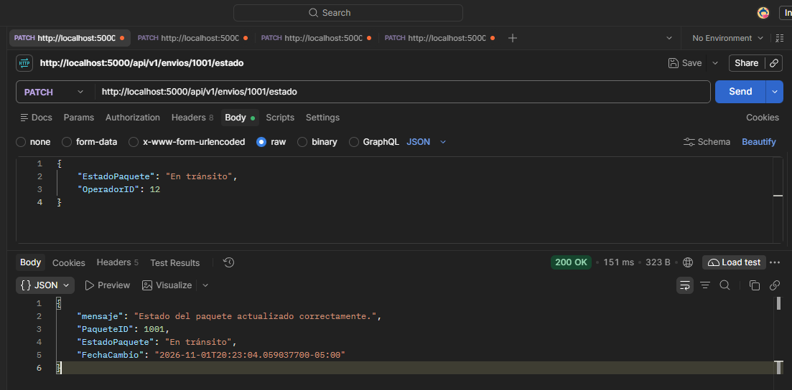
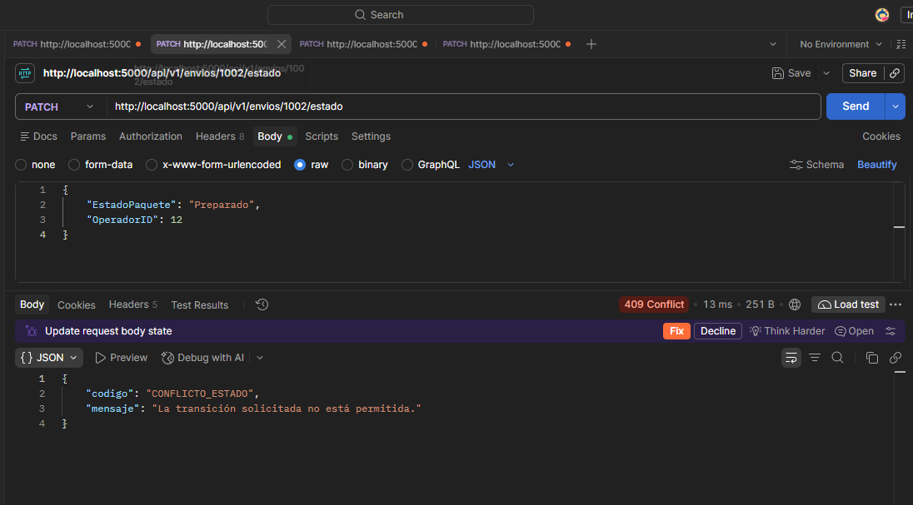
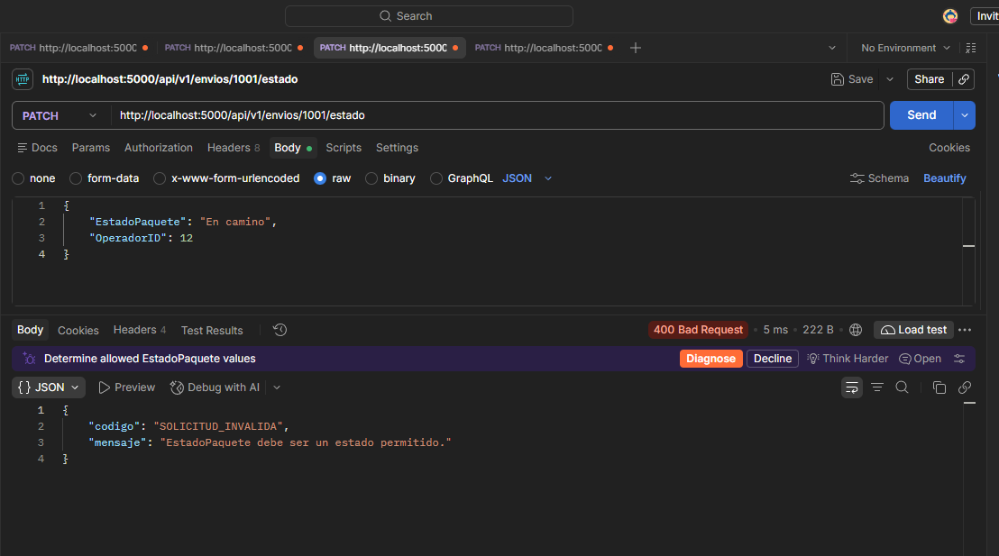

# Actividad 3.1: Construcción del software

## Proyecto: EnvíoFácil

**Asignatura:** Arquitectura y código  
**Equipo:** 
- Jesús Alejandro Cachon Rodríguez
- Luis Hernan Mezquita Castillo
- Willian Gaspar Montalvo Uh
- Jesús Alberto Canul Angulo 
- Sergio Antonio Chi Mis 

**Tecnología utilizada:** Java y Spring Boot  
**Entorno de desarrollo:** IntelliJ IDEA

---
# Actividad 3.1: Construcción del software

## Proyecto: EnvíoFácil

**Asignatura:** Arquitectura y código  
**Tecnología:** Java 17 y Spring Boot  
**Entorno de desarrollo:** IntelliJ IDEA  
**Herramienta de pruebas:** Postman  
**Arquitectura:** Clean Architecture

---

# 1. Introducción

Durante las actividades anteriores se desarrollaron diferentes artefactos que permitieron analizar las necesidades del sistema EnvíoFácil, definir sus reglas de negocio, identificar los datos necesarios y establecer la comunicación que tendría el software con otros componentes.

En esta actividad se retomaron esos elementos para construir una primera implementación funcional del backend utilizando Java y Spring Boot. El desarrollo no comenzó directamente con la escritura de código, sino que se utilizaron las historias de usuario, el diccionario de datos, la máquina de estados y el contrato OpenAPI como referencias para determinar qué información debía manejar el sistema y cómo debía comportarse.

El propósito de este documento es explicar cómo se utilizaron dichos artefactos durante la construcción del software, identificando su relación con las clases, los métodos, las validaciones y los servicios implementados.

# 2. Artefactos utilizados durante la construcción

## 2.1. Historias de usuario y escenarios Gherkin (AA1.2)

En la actividad AA1.2 se elaboraron las historias de usuario HU-01, HU-02 y HU-03. Estas describen las necesidades relacionadas con la cancelación de envíos, la corrección de direcciones y la conservación de la información financiera.

Las historias de usuario fueron utilizadas como referencia para comprender el comportamiento esperado del sistema y las restricciones que deberían respetarse durante su desarrollo.

Las principales necesidades identificadas fueron:

- HU-01: permitir cancelar un envío antes de que salga del almacén, conservando la información de la orden.
- HU-02: permitir corregir la dirección de destino antes del despacho, evitando generar órdenes o guías duplicadas.
- HU-03: conservar la información financiera y el historial de una orden cuando se realiza una cancelación.

Los escenarios Gherkin también permitieron identificar diferentes tipos de comportamiento: situaciones exitosas, errores y casos límite. Por ejemplo, se estableció que una operación no debe repetirse si ya fue realizada y que ciertas modificaciones deben rechazarse cuando el paquete se encuentra en ruta.

**Relación con el código desarrollado:**

Estos artefactos sirvieron como referencia para comprender que las operaciones del sistema deben representar acciones del negocio y no solamente modificaciones técnicas de registros.

En la implementación presentada para esta actividad se desarrolló específicamente la actualización del estado de un paquete. Las historias de usuario también establecen requisitos para las funcionalidades de cancelación, modificación de dirección y trazabilidad financiera, pero estas operaciones no forman parte del alcance del código implementado en esta versión.

Por lo tanto, las historias de usuario se utilizaron como contexto de los requisitos del sistema, sin afirmar que todas sus funcionalidades ya están programadas.

## 2.2. Diccionario de datos y modelo de información (AA2.1)

El diccionario de datos de AA2.1 permitió identificar los atributos que necesita manejar el sistema y comprender su significado dentro del proceso logístico.

A partir de este artefacto se identificaron los campos relacionados directamente con la actualización del estado de un paquete:

| Campo del diccionario | Uso durante la implementación |
|---|---|
| PaqueteID | Identifica el paquete que será actualizado. |
| EstadoPaquete | Representa el estado actual o solicitado del paquete. |
| OperadorID | Identifica al operador responsable de la solicitud. |
| FechaCambio | Registra la fecha y hora de la actualización. |

Estos campos se relacionaron con los elementos de Java de la siguiente manera:

- La clase `Paquete` representa el paquete que se administra en el sistema.
- El atributo `paqueteID` almacena su identificador.
- El atributo `estado` representa su situación dentro del proceso logístico.
- El atributo `fechaCambio` registra el momento en que se modifica el estado.
- El campo `OperadorID` se recibe como parte de la solicitud HTTP.

De esta manera, los atributos de la clase no se eligieron arbitrariamente, sino que se tomaron como referencia los datos definidos previamente en AA2.1.

## 2.3. Máquina de estados (AA2.1)

La máquina de estados se utilizó como referencia para establecer que un paquete no puede cambiar libremente entre cualquier estado.

En el diccionario de datos se identificaron los siguientes estados:

- Almacén.
- Preparado.
- En tránsito.
- Recibido.

Esta información se trasladó al código mediante el enumerador `EstadoPaquete.java`, donde se definieron los valores permitidos.

Posteriormente, en la clase `Paquete.java` se implementó el método `actualizarEstado()`, encargado de comprobar si el cambio solicitado está permitido.

Para esta versión se implementó la transición válida de Almacén a En tránsito, utilizando el ejemplo de despacho establecido en el contrato OpenAPI. También se contempla el rechazo de la transición de En tránsito a Preparado, definida como no permitida en AA2.3.

De esta forma, la máquina de estados dejó de ser únicamente un diagrama y se convirtió en una regla de validación dentro del dominio del programa.

## 2.4. Contrato OpenAPI 3.0 (AA2.3)

El contrato OpenAPI fue uno de los artefactos utilizados de manera más directa durante la implementación, ya que permitió definir la estructura del servicio HTTP.

En AA2.3 se especificó una operación para actualizar el estado de un paquete mediante el método PATCH.

**Endpoint definido:**

`PATCH /api/v1/envios/{id}/estado`

El contrato establece los siguientes elementos:

**Parámetros de entrada:**

- `id`: identificador del paquete.
- `EstadoPaquete`: nuevo estado solicitado.
- `OperadorID`: identificador del operador responsable.

**Respuesta exitosa:**

- `mensaje`: confirmación de la operación.
- `PaqueteID`: identificador del paquete actualizado.
- `EstadoPaquete`: estado registrado.
- `FechaCambio`: fecha y hora de la actualización.

También se definieron las respuestas de error:

- `400 Bad Request`: cuando el paquete no existe o los datos de entrada son inválidos.
- `409 Conflict`: cuando se solicita una transición de estado que no está permitida.

**Relación con el código desarrollado:**

El contrato se utilizó como guía para construir la clase `PaqueteController.java`, donde se definió la ruta y el método PATCH.

Además, se crearon las estructuras `SolicitudEstado` y `RespuestaEstado` para representar los datos recibidos y devueltos por el servicio.

De esta manera, la implementación mantiene una estructura de comunicación basada en lo establecido previamente en el contrato OpenAPI.

# 3. Relación entre los artefactos y las clases implementadas

Para comprender mejor cómo se utilizaron los artefactos, se presenta la siguiente relación entre los elementos de diseño y las clases desarrolladas.

| Artefacto de origen | Elemento implementado | Función dentro del software |
|---|---|---|
| AA1.2: Historias de usuario | Reglas de negocio consideradas durante el diseño | Identificar el comportamiento esperado y las restricciones. |
| AA2.1: Diccionario de datos | `Paquete.java` | Representar la información principal del paquete. |
| AA2.1: Diccionario de datos | `EstadoPaquete.java` | Definir los estados permitidos. |
| AA2.1: Máquina de estados | `Paquete.actualizarEstado()` | Validar las transiciones implementadas. |
| AA2.1: Identificador PaqueteID | `Paquete.paqueteID` | Identificar cada paquete. |
| AA2.1: Campo FechaCambio | `Paquete.fechaCambio` | Registrar el momento de la actualización. |
| AA2.3: Contrato OpenAPI | `PaqueteController.java` | Exponer el endpoint HTTP. |
| AA2.3: Solicitud ActualizacionEstado | `SolicitudEstado` | Recibir EstadoPaquete y OperadorID. |
| AA2.3: Respuesta RespuestaEstado | `RespuestaEstado` | Devolver los datos de la actualización. |

# 4. Aplicación de Clean Architecture

Además de los artefactos funcionales, la organización del código se realizó utilizando una separación por responsabilidades basada en Clean Architecture.

Las clases se distribuyeron de la siguiente manera:

## 4.1. Capa de dominio (Domain)

Contiene las clases que representan los conceptos principales del sistema y sus reglas de negocio.

- `Paquete.java`: representa un paquete y contiene sus atributos principales.
- `EstadoPaquete.java`: define los estados permitidos del paquete.

Esta capa utiliza la información del diccionario de datos y las reglas identificadas en la máquina de estados.

## 4.2. Capa de aplicación (Application)

Contiene la lógica que coordina las operaciones del sistema.

- `PaqueteRepository.java`: define las operaciones necesarias para consultar y guardar paquetes.
- `ActualizarEstadoPaquete.java`: implementa el caso de uso encargado de actualizar el estado de un paquete.

El caso de uso recibe el identificador, el nuevo estado y el operador. Después consulta el paquete, solicita la validación del cambio y guarda el resultado.

## 4.3. Capa de infraestructura (Infrastructure)

Contiene los elementos encargados de conectar la aplicación con el exterior.

- `PaqueteController.java`: recibe las solicitudes HTTP y devuelve las respuestas.
- `InMemoryPaqueteRepository.java`: implementa el almacenamiento temporal de paquetes en memoria.

La utilización de un repositorio en memoria permite realizar pruebas sin depender de una base de datos real.

## 4.4. Configuración de dependencias

La clase `AppConfig.java` permite crear los objetos necesarios y relacionarlos mediante sus constructores.

Con esto se evita que las clases principales dependan directamente de las implementaciones concretas de infraestructura.

# 5. Flujo de funcionamiento del software

La construcción de la funcionalidad se puede representar mediante el siguiente flujo:

1. El cliente envía una solicitud PATCH al endpoint definido en OpenAPI.
2. `PaqueteController.java` recibe el identificador y los datos de la solicitud.
3. El controlador envía la información al caso de uso `ActualizarEstadoPaquete.java`.
4. El caso de uso consulta el paquete mediante `PaqueteRepository.java`.
5. La entidad `Paquete.java` verifica si la transición solicitada está permitida.
6. Si la operación es válida, se actualiza el estado y la fecha del cambio.
7. El repositorio guarda el paquete actualizado.
8. El controlador devuelve la respuesta establecida en el contrato OpenAPI.

Este proceso demuestra cómo los artefactos elaborados durante las actividades anteriores se relacionan con las diferentes partes del software.

# 6. Pruebas de funcionamiento

Para comprobar la implementación se utilizó Postman, tomando como referencia los ejemplos y respuestas definidos en el contrato OpenAPI.

| Prueba | Datos enviados | Resultado esperado |
|---|---|---|
| Actualización válida | Paquete 1001: Almacén a En tránsito | 200 OK |
| Transición no permitida | Paquete 1002: En tránsito a Preparado | 409 Conflict |
| Estado no definido | Estado En camino | 400 Bad Request |
| Paquete inexistente | Identificador 9999 | 400 Bad Request |

Estas pruebas permiten comprobar que la implementación respeta los valores definidos en el diccionario de datos, las reglas de transición contempladas y la estructura de respuestas establecida en OpenAPI.

## 6.1. Evidencias de ejecución

**Evidencia 1. Ejecución del servidor Spring Boot**

**Evidencia 2. Actualización correcta del estado**

**Evidencia 3. Transición de estado no permitida**

**Evidencia 4. Validación de solicitud incorrecta**

# 7. Alcance de la implementación

La versión desarrollada para esta actividad se concentra en el caso de uso de actualización del estado de un paquete.

Aunque las historias de usuario de AA1.2 también describen la cancelación de envíos, la corrección de direcciones y la trazabilidad financiera, estas funcionalidades no se encuentran implementadas en el backend presentado.

Por otra parte, el almacenamiento utilizado es temporal y se realiza en memoria. Esto permite comprobar la lógica del servicio sin incorporar una base de datos real.

Esta distinción permite identificar qué requisitos fueron utilizados como referencia y cuáles se materializaron efectivamente en el código.

# 8. Conclusión

La construcción del backend de EnvíoFácil permitió utilizar los artefactos elaborados durante las actividades anteriores como referencia para desarrollar una funcionalidad concreta del sistema.

Las historias de usuario de AA1.2 ayudaron a comprender las necesidades y restricciones del proceso logístico. El diccionario de datos y la máquina de estados de AA2.1 permitieron identificar los atributos del paquete y las reglas que deben respetarse durante una actualización. Por su parte, el contrato OpenAPI de AA2.3 proporcionó la estructura del endpoint, los datos de entrada y las respuestas que debía entregar el servicio.

Al trasladar estos elementos al código Java, se construyeron las entidades, el caso de uso, el repositorio y el controlador que conforman la implementación.

Con este proceso se puede observar que los artefactos no fueron elaborados de manera independiente, sino que sirvieron como base para tomar decisiones durante la construcción del software. También se identificó qué funcionalidades están implementadas y cuáles permanecen como parte de los requisitos pendientes del sistema.
