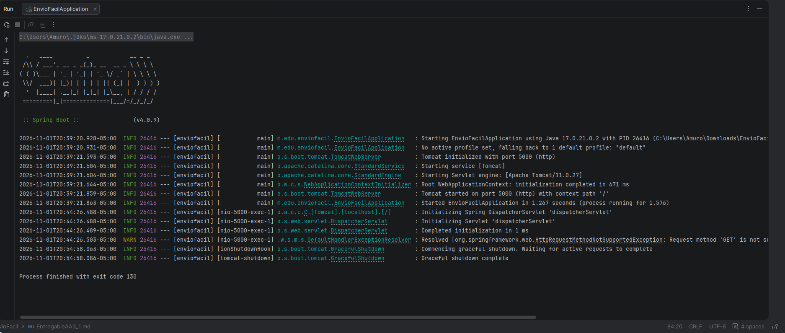

# Actividad 3.1: Construcción del software

## Proyecto: EnvíoFácil

**Asignatura:** Arquitectura y código  
**Equipo:** 
- Jesús Alejandro Cachon Rodríguez
- Luis Hernan Mezquita Castillo
- Willian Gaspar Montalvo Uh
- Jesús Alberto Canul Angulo 
- Sergio Antonio Chi Mis 

**Tecnología utilizada:** Java y Spring Boot  
**Entorno de desarrollo:** IntelliJ IDEA

---

## 1. Descripción del proyecto

El proyecto EnvíoFácil consiste en la construcción de un esqueleto funcional de software para gestionar operaciones relacionadas con los envíos de paquetes.

Para esta actividad se implementó un servicio backend utilizando Java y Spring Boot, tomando como referencia los diseños y contratos desarrollados en las actividades anteriores.

El sistema permite actualizar el estado de un paquete mediante un servicio HTTP, aplicando validaciones para evitar transiciones de estado no permitidas.

## 2. Tecnologías utilizadas

- Java 17.
- Spring Boot.
- Maven.
- IntelliJ IDEA.
- Postman para las pruebas HTTP.
- Git y GitHub para el control de versiones.

## 3. Arquitectura del software

Se organizó el proyecto utilizando una separación por responsabilidades basada en Clean Architecture.

Las principales capas son:

- **Domain:** contiene las entidades y los estados permitidos de los paquetes.
- **Application:** contiene los casos de uso y las interfaces de los repositorios.
- **Infrastructure:** contiene el controlador HTTP y la implementación del almacenamiento en memoria.
- **Config:** permite configurar las dependencias mediante inyección manual por constructores.

## 4. Funcionalidad implementada

Se implementó el endpoint para actualizar el estado de un paquete:

`PATCH /api/v1/envios/{id}/estado`

Ejemplo de solicitud:

```json
{
    "EstadoPaquete": "En tránsito",
    "OperadorID": 12
}
```

El servicio valida los identificadores, comprueba que el paquete exista y verifica que la transición solicitada esté permitida.

La persistencia se realiza temporalmente en memoria mediante una implementación de `PaqueteRepository`.

## 5. Pruebas HTTP

Se utilizará Postman para comprobar el comportamiento del servicio.

| Prueba | Resultado esperado | Resultado obtenido |
|---|---|---|
| Actualización válida | 200 OK | [Pendiente] |
| Transición inválida | 409 Conflict | [Pendiente] |
| Estado inexistente | 400 Bad Request | [Pendiente] |
| Paquete inexistente | 400 Bad Request | [Pendiente] |

### Evidencias

**Evidencia 1. Ejecución del servidor Spring Boot**



**Evidencia 2. Actualización correcta del estado**


**Evidencia 3. Transición de estado no permitida**


**Evidencia 4. Validación de solicitud incorrecta**


## 6. Repositorio de GitHub

**Enlace al repositorio:**

[Colocar aquí la URL del repositorio de GitHub.]

El repositorio contiene el código fuente del proyecto y el presente documento `EntregableAA3_1.md` en su directorio raíz.

## 7. Conclusión

La construcción del esqueleto funcional de EnvíoFácil permitió llevar los diseños realizados en actividades anteriores a una implementación inicial utilizando Java y Spring Boot.

Mediante la separación de responsabilidades se organizó el código para facilitar su mantenimiento y futuras modificaciones. También se implementó un servicio HTTP para actualizar el estado de los paquetes, incorporando validaciones para controlar las operaciones permitidas.

Finalmente, las pruebas con Postman permitirán comprobar las respuestas del servicio ante solicitudes correctas e incorrectas. El uso de GitHub facilitará la organización y entrega del código fuente junto con su documentación.
